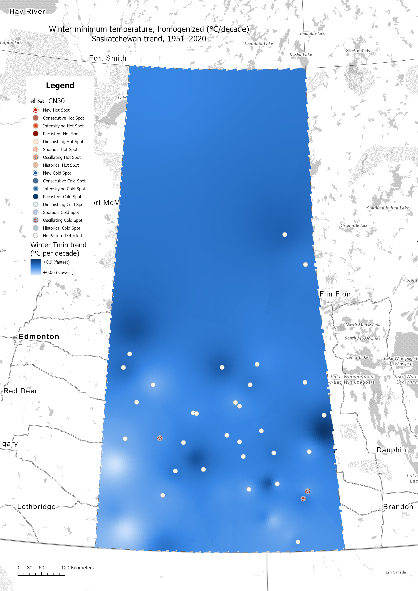
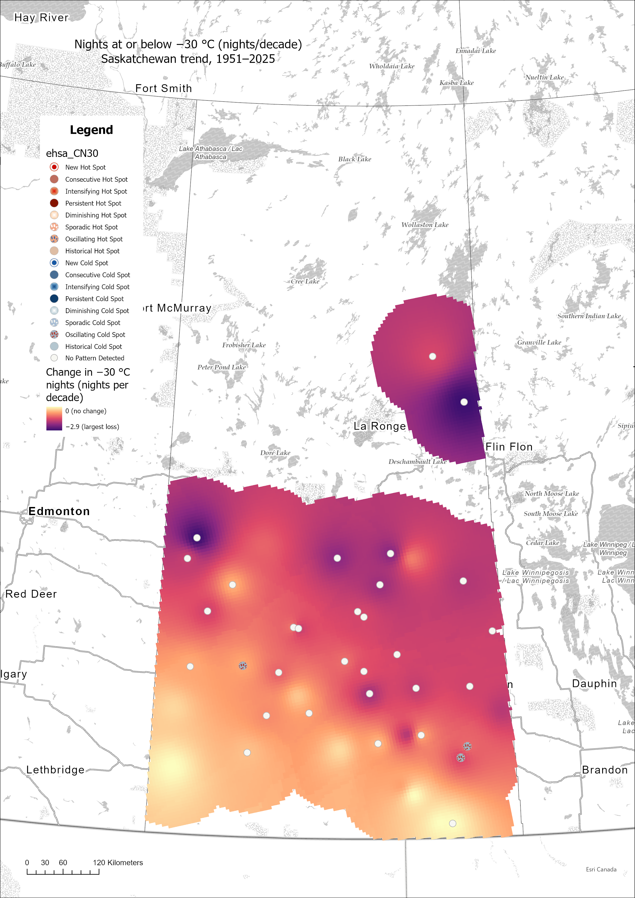
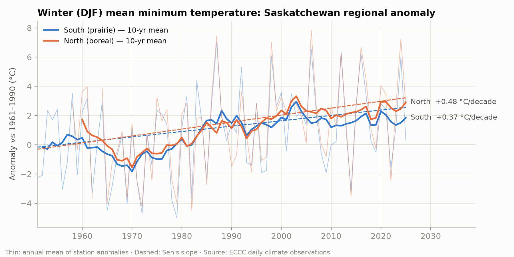
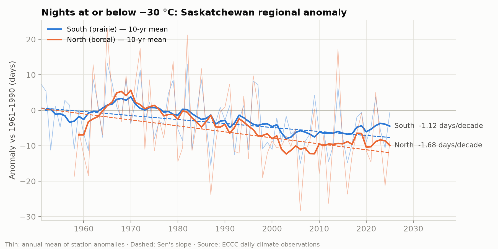
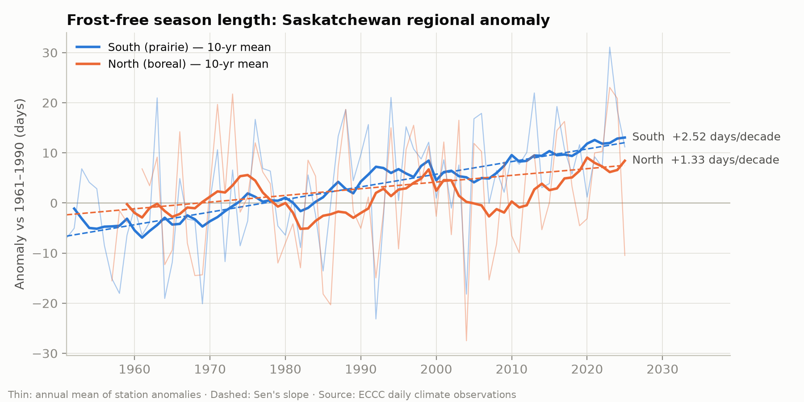

# Saskatchewan Cold Extremes: Historical Trends (1951–2025)

Is Saskatchewan losing its cold? This project measures long-term trends in cold
temperature extremes across the province, using Environment and Climate Change
Canada (ECCC) station data, Python for the statistics, and ArcGIS Pro for the
spatial analysis and mapping.

## Key findings
- **Winter nights are warming everywhere.** Mean winter (Dec–Feb) minimum temperature
  rose about **+0.37 °C per decade on the prairie** and **+0.48 °C per decade in the boreal
  north**, roughly 3 °C and 3.5 °C since 1951. No station shows significant winter cooling.
- **Extreme cold nights are disappearing.** Nights at or below −30 °C fell by about
  **1.1 per decade in the south** and **1.7 per decade in the north**. That is about 8–13
  fewer such nights per winter than in the 1950s. About half of all stations show a
  significant decline, and none shows an increase.
- **The frost-free season is longer.** On the prairie it grew by about **2.5 days per
  decade, roughly 19 days since 1951**. The last spring frost now comes about 9 days
  earlier and the first fall frost about 11 days later.
- **The boreal north is warming fastest.** By ecozone, winter minimum temperatures rose
  **+0.56 °C per decade in the Boreal Plain and Boreal Shield**, versus **+0.44 °C per decade
  on the Prairie**. The dry southwest warms slowest.
- **Nights are warming faster than days.** In the homogenized record, winter minimum
  temperatures rose faster (median +0.46 °C per decade) than winter maximums
  (+0.36 °C per decade).

## Results

### Maps (ArcGIS Pro)
<table>
<tr>
<td></td>
<td></td>
</tr>
<tr>
<td>Winter minimum temperature trend, homogenized AHCCD stations, 1951–2020 (IDW)</td>
<td>Change in nights ≤ −30 °C, 1951–2025 (IDW, mapped only within 100 km of a station)</td>
</tr>
</table>

On both maps, **darker = change toward warmer conditions**.

### Regional time series (Python)
| Winter minimum temperature | Nights ≤ −30 °C | Frost-free season |
|---|---|---|
|  |  |  |

### Regional trends (Sen's slope per decade, regional anomaly series)
| Indicator | South (prairie) | North (boreal, ≥ 54° N) |
|---|---|---|
| Winter mean minimum temperature | **+0.37 °C** (p = 0.03) | **+0.48 °C** (p = 0.02) |
| Coldest night of the year | +0.23 °C (n.s.) | **+0.45 °C** (p < 0.01) |
| Nights ≤ −30 °C | **−1.1 nights** (p < 0.01) | **−1.7 nights** (p = 0.02) |
| Nights ≤ −40 °C | **−0.05 nights** (p = 0.01) | **−0.44 nights** (p < 0.01) |
| Last spring frost | **−1.2 days** (earlier, p < 0.01) | −0.5 days (n.s.) |
| First fall frost | **+1.5 days** (later, p < 0.001) | +0.5 days (n.s.) |
| Frost-free season length | **+2.5 days** (p < 0.001) | +1.3 days (n.s.) |

Bold = statistically significant (p < 0.05). n.s. = not significant. The north has far
fewer stations, so its frost-season trends are less certain.

### Winter warming by ecozone (homogenized winter Tmin, 1951–2020)
| Ecozone | Area (km²) | Mean trend (°C per decade) |
|---|---|---|
| Boreal Plain | 172,000 | **+0.56** |
| Boreal Shield | 175,000 | **+0.56** |
| Taiga Shield | 47,000 | +0.52 (few stations) |
| Prairie | 238,000 | +0.44 |

By census division, the trend ranges from **+0.31 °C per decade** (Division 8, Swift
Current, southwest) to **+0.62 °C per decade** (Division 17, Lloydminster and Meadow Lake,
northwest). Full tables: [`outputs/tables/`](outputs/tables/).

### Station-level summary (40 composite stations with full coverage)
| Indicator | Median trend per decade | Stations with significant warming | Significant cooling |
|---|---|---|---|
| Nights ≤ −30 °C | −1.2 nights | 54 % | 0 % |
| Frost-free season | +2.4 days | 55 % | 0 % |
| Winter mean minimum temperature | +0.41 °C | 53 % | 0 % |
| Homogenized annual minimum temperature (AHCCD, 35 stations) | +0.23 °C | 91 % | 0 % |

"Significant" means q < 0.05 after a Benjamini-Hochberg false-discovery-rate correction
across stations.

## Research questions
1. Are extreme cold nights (≤ −30 °C, ≤ −40 °C) becoming rarer, and where?
2. Is winter warming faster in the boreal north than on the southern prairie?
3. Has the frost-free season lengthened (earlier last spring frost, later first fall frost)?
4. Where are cold extremes disappearing fastest, and is the change intensifying?

## Data
| Source | Content | Access |
|---|---|---|
| ECCC daily climate observations | Daily Tmin/Tmax: 139 composite stations with ≥ 40 years of data, built from 259 station records | `api.weather.gc.ca` (no key) |
| ECCC AHCCD (homogenized) | Seasonal/annual Tmin/Tmean/Tmax, 79 SK stations, to 2020 | `api.weather.gc.ca` (no key) |
| StatCan 2021 boundary files | Provinces (`lpr_000b21a_e`), census divisions (`lcd_000b21a_e`) | Manual download* |
| AAFC National Ecological Framework | Ecozones | Manual download* |

\* StatCan blocks scripted downloads. Get the shapefiles from the
[StatCan 2021 boundary files page](https://www12.statcan.gc.ca/census-recensement/2021/geo/sip-pis/boundary-limites/index2021-eng.cfm?year=21)
(cartographic boundary files, shapefile) and the
[ecozones](https://sis.agr.gc.ca/cansis/nsdb/ecostrat/gis_data.html), and unzip them into `data/boundaries/`.

**Why two station datasets?** The daily data is needed for extremes such as frost
days and −30 °C nights, but it is raw: station moves and instrument changes can
create false jumps. AHCCD is homogenized (adjusted for those breaks), so it is the
reliable reference for seasonal warming trends. Where the two agree, the result is
robust.

**Composite stations.** ECCC often closes a station and opens a replacement nearby
under a new climate ID (for example, many sites switched to automatic stations in the
1990s–2000s). On their own, most IDs are too short for a 1951–2025 trend: before
joining, only 11 stations qualified. Script 01 therefore joins a station to a successor
or predecessor that is ≤ 25 km away and within 100 m elevation, starts within 2 years
of the gap, and extends the record by ≥ 5 years. The merged record (`members` in
`stations_selected.csv`) favours the anchor station on overlapping days. A join can
still introduce a small step change, so the homogenized AHCCD trends serve as the check.

## Cold indices (per station, per year)
Cold seasons run July–June and are labelled by the year they end (winter 1999/2000 → 2000).

| Index | Meaning |
|---|---|
| `TNn` / `TXn` | Coldest night / coldest day of the season |
| `DJF_TN` / `DJF_TX` | Winter (Dec–Feb) mean min / max temperature |
| `FD` / `ID` | Frost days (Tmin < 0) / ice days (Tmax < 0) |
| `CN30` / `CN40` | Nights ≤ −30 °C / ≤ −40 °C |
| `LSF` / `FFF` / `FFS` | Last spring frost / first fall frost (day of year) / frost-free season length (calendar year) |

A season counts only if ≥ 85 % of its days and ≥ 90 % of Nov–Mar days are present.

## Methods
- **Trend test:** Mann-Kendall (tie-corrected) with Sen's slope, reported per decade.
- **Coverage rule:** ≥ 30 valid years, including ≥ 5 in each of the first and last 15 years.
- **Multiple testing:** Benjamini-Hochberg FDR across stations for each index (`q < 0.05`).
- **Regional series:** station anomalies vs. 1961–1990, averaged for south (prairie) and
  north (boreal, ≥ 54° N).
- **ArcGIS Pro:** IDW / Natural Neighbor / EBK trend surfaces (optionally limited to a
  distance from stations), a space-time cube with Emerging Hot Spot Analysis, zonal
  statistics by ecozone and census division, and batch layout export with `arcpy.mp`.

## Project structure
```
coldtrends/            Python package: config, ECCC API client, indices, trend stats
scripts/
  01_download_stations.py   SK station list + composite (joined) long daily records
  02_download_daily.py      Daily Tmin/Tmax per station (resumable)
  03_download_ahccd.py      AHCCD homogenized seasonal/annual temperatures
  04_compute_indices.py     Annual cold indices → data/processed/station_indices.csv
  05_compute_trends.py      MK/Sen trends + FDR → outputs/tables/
  06_make_figures.py        Regional time series + station trend maps → outputs/figures/
arcgis/ColdTrends.pyt  ArcGIS Pro Python toolbox (spatial analysis + map export)
gisProject/gisProject/ ArcGIS Pro project: gisProject.aprx, maps/ (geodatabase not committed)
outputs/               Trend tables and Python figures
run_pipeline.py        Runs scripts 01–06 in order
```

## How to run

### Part 1: Python (outside ArcGIS Pro)
Use a standalone Python 3.10+ install. ArcGIS Pro's `arcgispro-py3` isn't needed for
this part, and on some machines Windows Application Control blocks its pandas DLLs
when run from a terminal.
```bash
pip install -r requirements.txt
python run_pipeline.py
```
The daily download takes about 20–30 minutes the first time. It is resumable, so you
can rerun it if it stops.

### Part 2: ArcGIS Pro
1. Create a new Map project named `gisProject` with location `gisProject/` (this produces
   `gisProject/gisProject/gisProject.aprx` and `gisProject.gdb`). Then add `arcgis/ColdTrends.pyt`
   in the Catalog pane (Toolboxes → Add Toolbox). All tool outputs default to that project's
   geodatabase, with cubes in `cubes/` and exported maps in `maps/`.
2. **1. Prepare Boundaries**: the StatCan provinces, census divisions and ecozones shapefiles.
3. **2. Import Pipeline Results**: creates `station_trends`, `ahccd_trends` and `station_indices` point layers.
4. **3. Interpolate Trend Surface**:
   - `slope_Tmin_Win` from `ahccd_trends` (whole province)
   - `slope_CN30` from `station_trends` with *max distance* = `100 Kilometers`, because daily-data stations are sparse in the north
5. **4. Emerging Hot Spot Analysis**: e.g. `CN30` or `DJF_TN` on `station_indices`, with minimum fraction 0.7.
6. **5. Zonal Trend Summary**: a trend raster by `sk_ecozones` (`ZONE_NAME`) or `sk_census_divisions` (`CDNAME`).
7. **6. Export Trend Map Series**: set up one layout with a legend, scale bar and a text
   element *named* `Title`, then select the trend rasters. The tool sets the title, a
   sequential palette (dark = toward warmer), and readable legend labels.

Licences: tools 3 and 5 need Spatial Analyst, and the EBK option needs Geostatistical Analyst.

After changing `ColdTrends.pyt`, right-click it in Catalog → **Refresh**. Open the tool
from the toolbox, not from Geoprocessing History, or Pro may report "parameters need repair".

## Interpreting results
- **Map colours:** darker = change toward warmer conditions. For counts of cold
  nights, a *more negative* trend means more warming, so the ramp is reversed for those
  maps.
- **Emerging Hot Spot output:** a "hot spot" means *high values* of the index. For −30 °C
  nights, an *emerging cold spot* therefore means fewer extreme cold nights than at
  neighbouring stations, increasingly so over time.

## Limitations
- Station coverage is dense in the south and sparse north of about 55° N. Only 2 of the 40
  daily-data trend stations are in the north. Daily-index maps are therefore limited to
  areas near stations, and northern regional trends are less certain.
- Daily-data indices are not homogenized, and composite joins may add small breaks.
  The homogenized AHCCD trends agree in direction and size.
- Mann-Kendall assumes independent years. Autocorrelation can make p-values look
  stronger than they are, and pre-whitening would be a possible improvement.
- Possible extension: gridded ERA5-Land data (Copernicus CDS, free account) to fill the
  northern data gap.

## Data sources and licence
Climate data © Environment and Climate Change Canada, used under the
[Open Government Licence – Canada](https://open.canada.ca/en/open-government-licence-canada).
Boundaries © Statistics Canada; ecozones © Agriculture and Agri-Food Canada.
